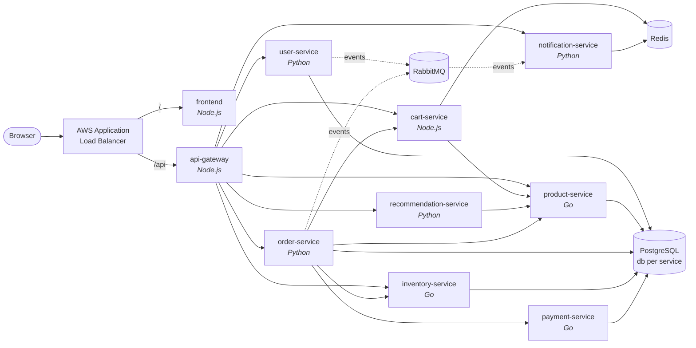

# ShopVerse — a production-grade microservices platform for Amazon EKS

ShopVerse is a complete e-commerce application made of **10 microservices** in three languages, plus everything a real platform team runs around it: Terraform infrastructure, a reusable Helm chart, GitOps with Argo CD, a CI/CD pipeline with image scanning, Prometheus/Grafana monitoring with alerts, zero-trust networking, secrets from AWS Secrets Manager, autoscaling, load testing and chaos engineering.

It exists for one purpose: **to give you real, hands-on Amazon EKS experience.** Deploy it, break it, fix it, scale it, upgrade it.

> **New here? Start with [docs/02-DEPLOYMENT-GUIDE.md](docs/02-DEPLOYMENT-GUIDE.md)** — a copy-paste, step-by-step guide that assumes no coding experience.
>
> 💸 Running on AWS costs about **$0.30–0.45/hour**. Always finish with `./scripts/99-destroy-everything.sh`.

---

## Architecture



| # | Service | Language | Owns | What it does |
|---|---|---|---|---|
| 1 | **frontend** | Node.js | — | Web storefront (single-page app) |
| 2 | **api-gateway** | Node.js | — | Routing, JWT auth, rate limiting, circuit breakers, `/api/status` |
| 3 | **user-service** | Python / FastAPI | PostgreSQL `users` | Sign-up, login (bcrypt + JWT), publishes `user.registered` |
| 4 | **product-service** | Go | PostgreSQL `products` | Product catalog |
| 5 | **cart-service** | Node.js | Redis | Shopping carts with live prices |
| 6 | **order-service** | Python / FastAPI | PostgreSQL `orders` | Checkout **saga** with compensation, transactional outbox |
| 7 | **inventory-service** | Go | PostgreSQL `inventory` | Stock + idempotent reservations with row locking |
| 8 | **payment-service** | Go | PostgreSQL `payments` | Simulated payments, idempotent, internal-only |
| 9 | **recommendation-service** | Python / FastAPI | in-memory cache | "You might also like", stale-while-error caching |
| 10 | **notification-service** | Python | Redis | RabbitMQ consumer, dead-letter queue, idempotent inbox |

More detail, including the checkout sequence diagram and the AWS network layout: [docs/01-ARCHITECTURE.md](docs/01-ARCHITECTURE.md).

---

## What makes it "production-grade"

**Application**
- Health endpoints: `/healthz` (liveness) and `/readyz` (readiness, checks owned dependencies only)
- Graceful shutdown on `SIGTERM` + `preStop` hook → zero-downtime rolling updates
- Structured JSON logs with a request ID propagated across every service
- Prometheus RED metrics with identical names in all 3 languages, plus business metrics
- Resilience: circuit breakers, timeouts, rate limiting, graceful degradation, idempotency
- Distributed transactions: saga orchestration with compensating actions
- Reliable events: transactional outbox → RabbitMQ → idempotent consumer + dead-letter queue
- Built-in chaos injection (error rate / latency) for the labs
- Unit tests run inside the Docker build (`--target test`)

**Containers & Kubernetes**
- Multi-stage Dockerfiles, non-root numeric users, distroless images for Go
- One reusable "golden path" Helm chart for all 10 services
- Startup/liveness/readiness probes, resource requests/limits, HPA, PodDisruptionBudgets
- Topology spread across Availability Zones, `maxUnavailable: 0` rollouts
- Pod Security Admission `restricted`, read-only root filesystems, dropped capabilities, seccomp
- Default-deny NetworkPolicies + explicit allow-lists (enforced by the VPC CNI)
- StatefulSets with encrypted gp3 EBS volumes for PostgreSQL, Redis, RabbitMQ
- CronJob (inventory restock), Helm test hooks, k6 load-test Job

**AWS & platform**
- Terraform with the official `terraform-aws-modules` (VPC, EKS 1.36, Pod Identity)
- EKS managed add-ons, managed node group on Spot with node auto-repair
- EKS Pod Identity (no static AWS keys anywhere in the cluster)
- AWS Load Balancer Controller with an IngressGroup (one shared ALB)
- External Secrets Operator syncing from AWS Secrets Manager
- kube-prometheus-stack with a custom Grafana dashboard and 9 alert rules
- Argo CD ApplicationSet (GitOps, auto-sync, self-heal)
- GitHub Actions: change detection, tests, Trivy scan, OIDC → ECR, automatic GitOps commit; actions pinned by SHA
- One-command teardown that cleans up in the right order

---

## Repository layout

```
shopverse-eks/
├── services/                 # the 10 microservices (code, tests, Dockerfile, README each)
├── infra/terraform/          # VPC, EKS, node group, add-ons, IAM, ECR, Secrets Manager, GitHub OIDC
├── deploy/
│   ├── helm/microservice/    # the reusable Helm chart
│   ├── helm/values/          # one values file per service (+ common.yaml)
│   ├── k8s/                  # namespaces, data stores, secrets, network policies, monitoring, load test
│   ├── platform/             # Helm values + pinned versions for the cluster add-ons
│   └── argocd/               # Argo CD project, ApplicationSet and apps (GitOps)
├── scripts/                  # numbered, copy-paste-friendly automation (00 → 99)
├── .github/workflows/        # CI/CD and lint pipelines
├── docs/                     # guides, labs, runbooks
├── docker-compose.yml        # run everything locally for free
└── Makefile                  # shortcuts: make help
```

---

## Quick start

**Locally (free, no AWS):**
```bash
docker compose up --build -d     # then open http://localhost:8080
```

**On Amazon EKS** (details in the [deployment guide](docs/02-DEPLOYMENT-GUIDE.md)):
```bash
./scripts/00-check-prereqs.sh          # tools + AWS login
./scripts/01-create-infrastructure.sh  # Terraform: VPC + EKS + ECR (~20 min)
./scripts/02-configure-repo.sh         # write your account/region into the config
./scripts/03-install-platform.sh       # ALB controller, monitoring, secrets, Argo CD (~10 min)
./scripts/04-build-and-push-images.sh  # build + push 10 images (~15 min)
./scripts/05-deploy-app.sh             # deploy, prints the store URL
# ... practise ...
./scripts/99-destroy-everything.sh     # delete everything
```
Or use `make help` for the same steps as `make infra`, `make deploy`, etc.

---

## Documentation

| Guide | What's inside |
|---|---|
| [01 — Architecture](docs/01-ARCHITECTURE.md) | Diagrams, request and event flows, security layers, design decisions |
| [02 — Deployment guide](docs/02-DEPLOYMENT-GUIDE.md) | **Start here.** Step-by-step, no coding needed |
| [03 — CI/CD & GitOps](docs/03-CICD-GITOPS.md) | GitHub Actions + Argo CD: deploy by pushing to Git |
| [04 — Observability](docs/04-OBSERVABILITY.md) | Grafana, PromQL, logs, tracing a request, alerts |
| [05 — Hands-on labs](docs/05-HANDS-ON-LABS.md) | 20 exercises: scale, break, fix, upgrade |
| [06 — Troubleshooting](docs/06-TROUBLESHOOTING.md) | Runbook: symptom → commands → fix |
| [07 — Cost & cleanup](docs/07-COST-AND-CLEANUP.md) | What costs money and how to keep it low |
| [08 — Interview prep](docs/08-INTERVIEW-PREP.md) | How to talk about this project, resume bullets |

---

## Pinned versions (October 2026)

| Component | Version |
|---|---|
| Amazon EKS / Kubernetes | 1.36 (upgrade to 1.37 is Lab 19) |
| Terraform modules | eks 21.29 · vpc 6.7 · eks-pod-identity 2.9 · AWS provider 6.x |
| AWS Load Balancer Controller | chart 3.6.0 |
| External Secrets Operator | chart 2.12.0 |
| kube-prometheus-stack | chart 92.3.1 |
| Argo CD | chart 10.10.3 (Argo CD 3.5) |
| metrics-server | chart 3.14.0 |
| Runtimes | Node.js 24 · Python 3.13 · Go 1.26 · PostgreSQL 17 · Redis 7.4 · RabbitMQ 4.2 · k6 2.3 |

Add-on versions live in [`deploy/platform/versions.env`](deploy/platform/versions.env) — upgrading is a one-line change.

---

## License

MIT — use it, change it, put it on your résumé.
