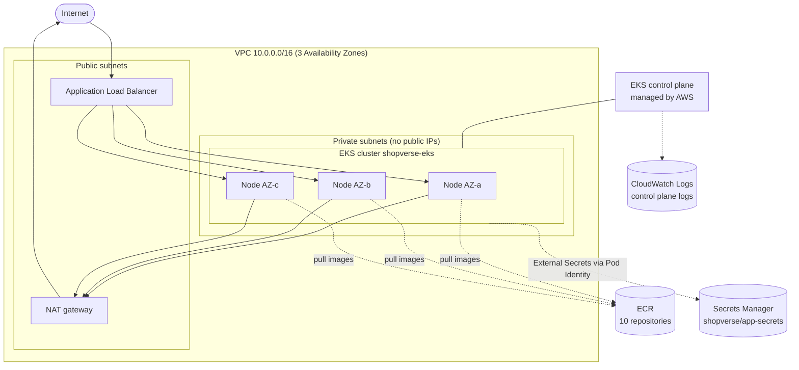
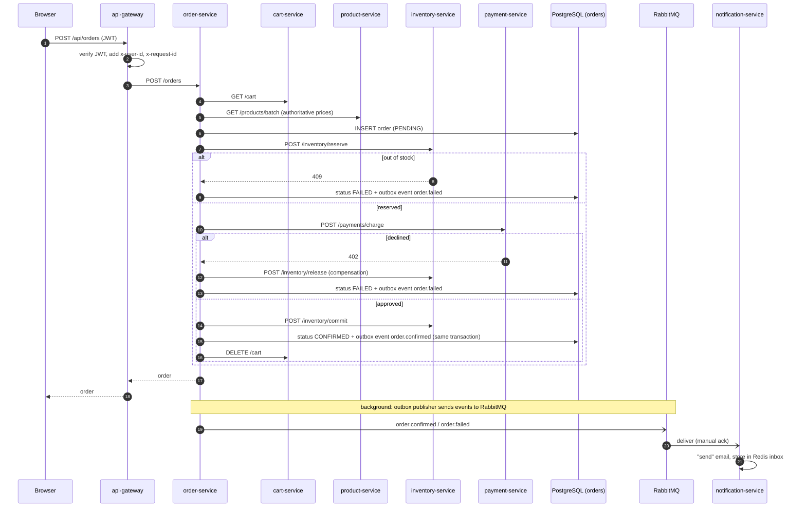

# Architecture

This document explains **how ShopVerse works and why it is built this way**. Read it after your first successful deployment — it will make far more sense once you've clicked around the running store.

---

## 1. The AWS layer



| Resource | Created by | Notes |
|---|---|---|
| VPC, subnets, NAT gateway | `infra/terraform/vpc.tf` | Private /20 subnets give thousands of pod IPs (the VPC CNI assigns real VPC IPs to pods). One NAT gateway to save money; production uses one per AZ. |
| EKS cluster | `infra/terraform/eks.tf` | Kubernetes 1.36, public API endpoint (restrict it with `cluster_endpoint_public_access_cidrs`), access entries for authentication. |
| Managed node group | `eks.tf` | 3 × 2 vCPU / 8 GiB, Spot by default, Amazon Linux 2023, node auto-repair, SSM access instead of SSH. |
| EKS managed add-ons | `eks.tf` | VPC CNI (with **network policy enforcement on**), CoreDNS, kube-proxy, Pod Identity Agent, EBS CSI driver. |
| IAM roles for add-ons | `infra/terraform/pod-identity.tf` | **EKS Pod Identity**: the EBS CSI driver, the Load Balancer Controller and External Secrets each get a dedicated, least-privilege IAM role. No AWS keys in the cluster. |
| ECR repositories | `infra/terraform/ecr.tf` | Scan on push, lifecycle policy (keep 30 images), `force_delete` so teardown is clean. |
| Secrets | `infra/terraform/secrets.tf` | Random passwords + JWT key in one JSON secret. Never in Git. |
| GitHub OIDC role | `infra/terraform/github-oidc.tf` | Lets GitHub Actions (main branch only) push to ECR without stored keys. |

---

## 2. The Kubernetes layer

```
namespace kube-system       AWS Load Balancer Controller, metrics-server, CoreDNS, CSI/CNI agents
namespace external-secrets  External Secrets Operator
namespace monitoring        Prometheus, Alertmanager, Grafana, kube-state-metrics, node-exporter
namespace argocd            Argo CD
namespace shopverse         the 10 microservices          (Pod Security: restricted)
namespace shopverse-data    PostgreSQL, Redis, RabbitMQ   (Pod Security: baseline)
```

Every microservice is deployed by the **same Helm chart** (`deploy/helm/microservice`) with its own values file. For each service the chart creates:

| Object | Purpose |
|---|---|
| Deployment | Runs the pods: probes, resources, security context, rolling update with `maxUnavailable: 0`, spread across zones and nodes |
| Service | Stable DNS name (`http://cart-service`) and load balancing across pods |
| ConfigMap | Non-secret settings. Its hash is a pod annotation, so a config change triggers a rolling restart |
| ServiceAccount | Identity of the pod (token not mounted: none of the services call the Kubernetes API) |
| HorizontalPodAutoscaler | 2 → 6 replicas based on CPU and memory |
| PodDisruptionBudget | Keeps at least 1 pod during node drains and upgrades |
| NetworkPolicy | Only the listed callers can reach the service |
| ServiceMonitor | Tells Prometheus to scrape `/metrics` |
| Ingress *(frontend, api-gateway)* | Rules on one shared ALB (`group.name: shopverse`): `/api` → gateway, `/` → frontend |
| Test pod | `helm test <service>` checks `/healthz` |

### Who may talk to whom (NetworkPolicies)

| Service | Allowed callers |
|---|---|
| frontend, api-gateway | anyone (internet via the ALB) |
| user, order, recommendation, notification | api-gateway |
| product-service | api-gateway, cart-service, order-service, recommendation-service |
| cart-service | api-gateway, order-service |
| inventory-service | api-gateway, order-service, the restock CronJob |
| payment-service | order-service (and api-gateway for its health page) |
| PostgreSQL | the 5 services that own a database |
| Redis | cart-service, notification-service |
| RabbitMQ | user-service, order-service, notification-service |

Everything else is blocked by a `default-deny-ingress` policy in each namespace. Prometheus (namespace `monitoring`) may scrape metrics everywhere.

---

## 3. Request flow: what happens when you click "Place order"



### Patterns to notice

**Saga (orchestration).** A checkout touches four services, and there is no distributed transaction across their databases. order-service runs the steps in order and, when a step fails, runs **compensating actions** for the earlier ones (release stock, refund payment). Try it: pay with the *declined* test card and watch the stock come back.

**Transactional outbox.** Saving an order and publishing an event are two different systems. If the pod crashed between them, the event would be lost. Instead, the event is written to an `outbox` table **in the same database transaction** as the order. A background loop publishes it to RabbitMQ and marks it sent. Multiple replicas use `FOR UPDATE SKIP LOCKED` so they never send the same row concurrently. Delivery is *at-least-once*.

**Idempotent consumer + dead-letter queue.** Because events can arrive twice, notification-service remembers processed `event_id`s in Redis and ignores duplicates. A message it cannot process (malformed JSON) is rejected to `notification-service.dlq` instead of being retried forever.

**Idempotent APIs.** Charging or reserving stock twice for the same `order_id` returns the original result. Retries are safe.

**Database per service.** Each service has its own PostgreSQL database and login. No service can read another's tables; they communicate only through APIs and events.

**Circuit breaker.** If an upstream keeps failing, api-gateway stops calling it for 10 seconds and returns `503` immediately, giving it room to recover (state is exported as a metric and alerted on).

**Graceful degradation.** If recommendation-service is down, the store still works — the product dialog just shows no suggestions. If product-service is down, recommendation-service serves its last cached catalog.

**Readiness ≠ liveness.** `/healthz` only says "the process is alive". `/readyz` checks the dependencies the service *owns* (its database or Redis). It deliberately does **not** check other microservices: if every service became unready when product-service failed, one failure would take down the whole platform.

---

## 4. Security layers

| Layer | Mechanism |
|---|---|
| Identity for AWS | EKS Pod Identity — per-add-on IAM roles, no access keys |
| Identity for CI | GitHub OIDC → IAM role restricted to the `main` branch of your repo |
| Secrets | Generated by Terraform → AWS Secrets Manager → External Secrets → Kubernetes Secret → env var |
| User auth | bcrypt password hashing, HS256 JWT verified at the gateway; spoofed `x-user-*` headers are stripped |
| Network | Default-deny NetworkPolicies + allow-lists, private subnets for nodes, payment-service never exposed |
| Pods | PSA `restricted`, non-root numeric UID, read-only root FS, all capabilities dropped, seccomp `RuntimeDefault`, no service account token |
| Images | Minimal/distroless bases, Trivy scan in CI, ECR scan on push, actions pinned by SHA |
| Web | Content-Security-Policy, `X-Frame-Options`, `nosniff`, rate limiting |

---

## 5. Observability design

Every service, in every language, exposes the same metric names:

```
http_requests_total{method, route, status_code}
http_request_duration_seconds_bucket{method, route, status_code, le}
app_build_info{version}
```

Because Prometheus adds `namespace`, `service` and `pod` labels when it scrapes, a single Grafana dashboard covers all 10 services. Business metrics (`orders_total`, `payments_total`, `notifications_sent_total`, `outbox_pending_events`, `gateway_circuit_breaker_state`, …) sit next to the technical ones. Logs are one JSON object per line with `service`, `version`, `pod` and `request_id`. See [04-OBSERVABILITY.md](04-OBSERVABILITY.md).

---

## 6. Design decisions and trade-offs

| Decision | Why | What production would often do instead |
|---|---|---|
| PostgreSQL/Redis/RabbitMQ **inside** the cluster | Cheap, teaches StatefulSets, PVCs and EBS | Amazon RDS/Aurora, ElastiCache, Amazon MQ — managed backups, Multi-AZ, patching |
| One NAT gateway | Saves ~$65/month | One NAT gateway per AZ for resilience |
| Spot worker nodes | ~60–70% cheaper | Mix of On-Demand (baseline) and Spot, or Karpenter |
| Fixed-size node group | Simple | Karpenter or Cluster Autoscaler (Lab 20) |
| Polyglot (Node.js, Python, Go) | Real companies are polyglot; shows the platform is language-agnostic | Same |
| Synchronous saga over HTTP | Easy to follow in logs | Sometimes a choreographed (event-driven) saga or a workflow engine (Temporal, Step Functions) |
| HS256 JWT shared by user-service and gateway | Simple | Asymmetric keys (RS256/ES256) with a JWKS endpoint, or an identity provider (Cognito) |
| In-memory rate limiter per gateway pod | No extra dependency | Distributed limiter (Redis) or AWS WAF rate rules |
| Schema migrations on startup | Zero extra tooling | Flyway/Liquibase/Alembic/Atlas run as a Job or pre-sync hook |
| Port-forward to dashboards | Nothing exposed publicly | Internal ALB + SSO (OIDC) in front of Grafana/Argo CD |
| No service mesh | Keeps the learning curve manageable | Istio/Linkerd for mTLS, L7 authorization and retries |
