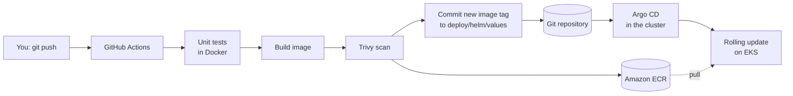

# CI/CD and GitOps

In real teams nobody runs `helm upgrade` from their laptop. The flow is:



- **CI** (GitHub Actions) proves the code works and produces a scanned image.
- **CD** is GitOps: the pipeline never touches the cluster. It only changes Git. **Argo CD**, running inside the cluster, continuously makes the cluster match Git.

Why GitOps? Every change is a reviewed commit, rollback is `git revert`, the cluster can be rebuilt from Git, and CI needs no cluster credentials.

---

## One-time setup (≈15 minutes)

You need the platform from the deployment guide (steps 0–5) already running.

### 1. Put the project on GitHub

If you didn't in the deployment guide (step A4): create an **empty** GitHub repository called `shopverse-eks`, then from the project folder:

```bash
git init -b main
git add -A
git commit -m "Initial import of ShopVerse"
git remote add origin https://github.com/<your-user>/shopverse-eks.git
git push -u origin main
```

> **Public or private?** Public is simplest (Argo CD can read it without credentials) and safe: there are no secrets in this repo. For a private repo, see step 4.

### 2. Let GitHub Actions push images to ECR (keyless)

Edit (or create) `infra/terraform/terraform.tfvars` and add:
```hcl
github_repository = "<your-user>/shopverse-eks"
```
Apply the change (it only adds an OIDC provider and one IAM role):
```bash
./scripts/01-create-infrastructure.sh
./scripts/02-configure-repo.sh      # prints the values for the next step
```

> If Terraform says the OIDC provider `token.actions.githubusercontent.com` **already exists**, your account has one from another project: add `create_github_oidc_provider = false` and run it again.

### 3. Add two repository variables

GitHub → your repo → **Settings → Secrets and variables → Actions → Variables tab → New repository variable**:

| Name | Value |
|---|---|
| `AWS_REGION` | e.g. `us-east-1` |
| `AWS_ROLE_ARN` | `arn:aws:iam::<account>:role/shopverse-eks-github-actions` (printed by `02-configure-repo.sh`) |

These are *variables*, not secrets — an IAM role ARN isn't sensitive. The trust policy only accepts tokens from the `main` branch of your repository.

Also allow the workflow to commit: **Settings → Actions → General → Workflow permissions → "Read and write permissions"** → Save.

### 4. Turn on GitOps

Commit and push your current state first (image tags and account settings must be in Git):
```bash
git add -A && git commit -m "Configure account and image tags" && git push
```
Then:
```bash
./scripts/06-setup-gitops.sh https://github.com/<your-user>/shopverse-eks.git
```
Private repository? Create a GitHub *fine-grained personal access token* with **Contents: Read-only** on this repo and run:
```bash
GITHUB_TOKEN=github_pat_xxx ./scripts/06-setup-gitops.sh https://github.com/<your-user>/shopverse-eks.git
```

What the script does:
1. Removes Helm's release records for the 10 services (the running pods are untouched).
2. Creates an Argo CD **AppProject** (what Argo may deploy, and where).
3. Creates an **ApplicationSet** that generates one Application per microservice, plus Applications for the data stores, namespace extras and monitoring rules.
4. Argo CD adopts the running resources — zero downtime.

Open Argo CD (`./scripts/08-open-dashboards.sh` → <http://localhost:8080>) and you'll see 13 applications turn **Synced / Healthy**.

---

## Your first GitOps deployment

1. Change something visible. For example, in `services/frontend/public/app.js` replace
   `Gear for builders.` with `Gear for cloud builders.`
2. Commit and push:
   ```bash
   git add -A && git commit -m "frontend: new headline" && git push
   ```
3. Watch **GitHub → Actions**: the *CI/CD* workflow detects that only `frontend` changed, runs its tests, builds the image, scans it, pushes it to ECR and commits `deploy: frontend -> abc1234 [skip ci]`.
4. Within ~1 minute Argo CD notices the new commit and performs a rolling update:
   ```bash
   kubectl -n shopverse get pods -l app.kubernetes.io/name=frontend -w
   ```
5. Refresh the store — new headline. The Platform page shows the new version.

### Rollback

Find the bad deploy commit and revert it:
```bash
git log --oneline -5
git revert <commit-sha-of-the-deploy-commit>
git push
```
Argo CD rolls back to the previous image within a minute. (You can also click **History and rollback** in the Argo CD UI, but it will drift from Git — reverting the commit is the GitOps way.)

### Pull requests

Open a PR that changes a service: the pipeline runs tests, builds and scans, but **does not push or deploy**. Merge it and the push to `main` deploys it.

---

## Things to try

- **Self-healing:** make a manual change that isn't in Git — `kubectl -n shopverse set env deploy/cart-service HELLO=world` — and watch Argo CD undo it within seconds. `kubectl -n shopverse delete svc cart-service` — Argo recreates it. (Replica counts are owned by the HPA, not Git, so `kubectl scale` is reverted by the autoscaler instead.)
- **Config change via Git:** add `LOG_LEVEL: debug` under `env:` in `deploy/helm/values/order-service.yaml`, push, and watch the pods restart with debug logs (the ConfigMap checksum annotation triggers the rollout).
- **Chaos the GitOps way:** add `CHAOS_ERROR_RATE: "0.3"` to a service's `env:`, push, watch the Grafana error panel and the `ShopverseHighErrorRate` alert. Revert to recover.
- **Scale a service permanently:** change `autoscaling.minReplicas` in its values file.

---

## After you destroy and recreate the environment

Argo CD's configuration lives in the cluster, so after `99-destroy-everything.sh` and a fresh steps 1–4:
- Images: run `./scripts/04-build-and-push-images.sh` (or trigger the workflow manually: Actions → CI/CD → *Run workflow*), commit and push the tags.
- Run `./scripts/06-setup-gitops.sh <repo-url>` instead of `05-deploy-app.sh`. Argo CD deploys the data stores and all services from Git.

> The GitHub variables stay valid only if the role name and account are unchanged (they are, unless you changed `cluster_name`).

---

## How the pipeline files are organised

| File | Runs on | Does |
|---|---|---|
| `.github/workflows/ci-cd.yaml` | PRs and pushes touching `services/` | detect changed services → test → build → Trivy → (main only) push to ECR → commit new tags |
| `.github/workflows/lint.yaml` | PRs and pushes touching `infra/`, `deploy/`, `scripts/` | `terraform fmt/validate`, `helm lint`, render + `kubeconform` schema validation, ShellCheck |

Supply-chain hardening: every third-party action is pinned to a full commit SHA, the workflow token defaults to read-only, and only the deploy job gets `contents: write`.

If `main` is protected by a branch-protection rule, the bot's tag commit will be rejected. Either allow GitHub Actions to bypass the rule, or change the deploy job to open a pull request instead (a good exercise!).
